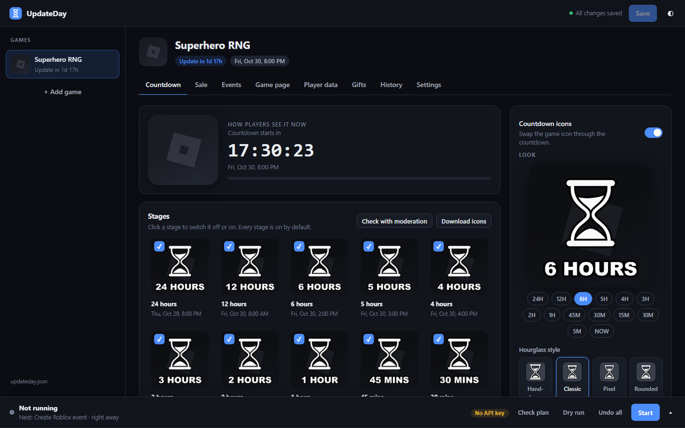

# UpdateDay

**Free, open-source update-day automation for Roblox games.**

Pick an update time and UpdateDay runs the whole day for you: countdown icons and titles, a sale, a Roblox event,
in-game warnings and server restarts. Everything is put back exactly as it was afterwards. It runs on your own
computer with an Open Cloud API key, needs no logins or cookies, and there's no UpdateDay server.



## What it can do

Everything is optional and off until you turn it on.

- **Countdown icons** built from your game's own icon: 24 hours … 5 minutes, then NOW. Pick a style (hand-drawn,
  classic, pixel, rounded, glow, blocky, outline) or upload your own art, and move and resize the hourglass and the text.
- **Title countdown**: "[6H] Your Game" → "[LIVE] Your Game" → back to normal, for players in your game's main language.
- **Moderation check**: Roblox reviews every icon days ahead, so nothing gets rejected on the day.
- **Sale**: X% off game passes and products, with "[30% OFF]" name tags. Every price and name goes back afterwards.
- **Events**: create and edit Roblox events, or get one made automatically for every update.
- **In-game**: warnings before the update, a live "UPDATE IN 04:59" banner, and old servers restarted onto the new version.
- **Alerts**: Discord messages (with the icon to upload attached) and desktop pop-ups.
- **Extras**: several games at once, repeating updates, a game page checklist, a history of everything it did,
  a player-data editor with backups, gifts, translated labels in 15 languages, and an [AI agent hook](docs/AGENTS.md).

## Start in 3 minutes

**1. Install [Node.js](https://nodejs.org) 22.18 or newer.**

**2. Open the setup page** in any folder you like:

```bash
npx updateday ui updateday.json
```

It opens on `http://127.0.0.1:4747`, which only your own computer can reach.

**3. Add your game**: paste its Roblox link (`https://www.roblox.com/games/...`) in **Settings**.

**4. Make an API key**: Creator Hub → **Open Cloud → API Keys → Create API Key**. Add your experience, then add the
permissions for the features you want:

| Feature | Permission to add |
|---|---|
| Always | Universe: read |
| Countdown icons | Legacy universe: manage |
| Title countdown | Places: read + write |
| Moderation check | Assets: read + write |
| Sale | Game passes: read + write, Developer products: read + write |
| Events | Universe events: read + write |
| In-game warnings and banner | Messaging service: publish |
| Server restarts | Universe: write |
| Player data and gifts | DataStore: list stores, read, create and update entries |

Paste the key in the page (the **▴** at the bottom right). It's kept in memory only and never saved to disk.
**Check plan** tells you if a permission is missing.

**5. Plan it**: set the update time, choose what you want in each tab, and press **Save**.

**6. Press Start** and leave the page open. **Check plan** runs first and tells you if anything needs fixing.
Changed your mind? **Undo all** puts every price, name, title and icon back.

## Good to know

- **The main game icon.** Roblox doesn't let API keys change a game's main icon. UpdateDay either reminds you to
  upload each finished icon (with a download button and a Discord alert), or does it automatically with a
  *language swap*: it briefly makes another language the game's main one and sets the countdown for every
  other language. Players whose Roblox language is that temporary one see your normal icon.
  [More in the guide](docs/GUIDE.md#how-the-icon-changes-on-roblox).
- **Safe by design.** Original prices, names and titles are saved before anything changes, and every change is
  read back. If UpdateDay is closed or crashes part-way, it picks up where it left off.
- **PC off?** Run it from GitHub Actions instead. [See the guide](docs/GUIDE.md#with-your-pc-off-github-actions).
- **In your game:** download the Roblox kit from **Settings** for the countdown banner and warning pop-ups.
  [See the guide](docs/GUIDE.md#in-game-countdown).

## Using the terminal instead

The page and these commands share the same `updateday.json`, so you can mix them.

```bash
npx updateday check updateday.json     # pre-flight check
npx updateday plan updateday.json      # the full schedule
npx updateday preview updateday.json   # every countdown icon into ./preview
npx updateday watch updateday.json     # run it
npx updateday restore updateday.json   # undo everything now
```

The key comes from the `UPDATEDAY_API_KEY` environment variable. Every setting is in the [guide](docs/GUIDE.md).

## For AI agents

`npx updateday mcp updateday.json` runs UpdateDay as an MCP server. Claude, Cursor and other agents can then plan
and check update days for you. Anything that changes your live game needs an explicit confirmation.
See [docs/AGENTS.md](docs/AGENTS.md).

## Contributing

```bash
git clone https://github.com/hiyouwhatsapp/UpdateDay && cd UpdateDay
npm install
npm test          # unit tests, a full update day against a fake Roblox, edge cases, security
npm run test:ui   # every tab at desktop and phone size, light and dark (needs Chrome)
node src/cli.ts ui example/updateday.json
```

Issues and pull requests are welcome. [docs/COVERAGE.md](docs/COVERAGE.md) lists every Roblox API UpdateDay uses.

## License

MIT. Free for everyone, forever.
